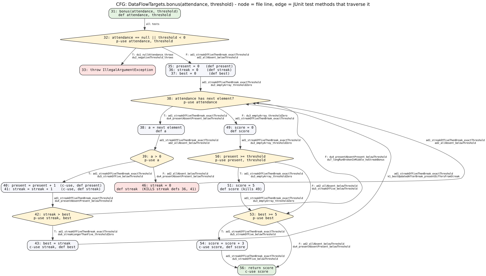

# Лаб 10 — Өгөгдлийн урсгалын тест (Definition-Use хосууд)

F.CSA313 — Программ хангамжийн чанарын баталгаа ба тест (2026)

- **Нэр:** Бямбажавын Отгонсүх (Б.Отгонсүх)
- **Оюутны код:** B242270021
- **Репо:** https://github.com/Oogii852/lab10-dataflow

### `java -version`

<!-- BEGIN java-version -->
```
openjdk version "25.0.5.0.3" 2026-10-24
OpenJDK Runtime Environment (build 25.0.5.0.3+1-1-26.04.1-Ubuntu)
OpenJDK 64-Bit Server VM (build 25.0.5.0.3+1-1-26.04.1-Ubuntu, mixed mode, sharing)
```
<!-- END java-version -->

### `mvn -version`

<!-- BEGIN mvn-version -->
```
Apache Maven 3.9.12
Maven home: /usr/share/maven
Java version: 25.0.5.0.3, vendor: Ubuntu, runtime: /usr/lib/jvm/java-25-openjdk-amd64
Default locale: en_US, platform encoding: UTF-8
OS name: "linux", version: "7.0.0-43-generic", arch: "amd64", family: "unix"
```
<!-- END mvn-version -->

## Хэсэг A: gcd — бүрэн DU хүснэгт

Мөрийн дугаар нь `DataFlowTargets.java` файлын мөр (слайдын 1→13, 3→15, 4→16, 5→17, 6→18, 8→20).

| Мөр | Def | Use |
|---|---|---|
| 13 `gcd(int x, int y)` | x, y | — |
| 14 `int tmp;` | — (зөвхөн зарлалт, утга оноогоогүй тул def биш) | — |
| 15 `while (y != 0)` | — | y (p-use) |
| 16 `tmp = x % y;` | tmp | x, y (c-use) |
| 17 `x = y;` | x | y (c-use) |
| 18 `y = tmp;` | y | tmp (c-use) |
| 20 `return x;` | — | x (c-use) |

p-use-ийг ирмэгээр нь бичив: (15,16) = нөхцөл True, (15,20) = нөхцөл False.

| # | Хувьсагч | Def мөр | Use мөр | c/p-use | Def-clear зам | Тестийн ID | Хамрагдсан |
|---|---|---|---|---|---|---|---|
| 1 | x | 13 | 16 | c-use | 13→14→15(T)→16 | G2, G3, G4 | Тийм |
| 2 | x | 13 | 20 | c-use | 13→14→15(F)→20 | G1 | Тийм |
| 3 | x | 17 | 16 | c-use | 17→18→15(T)→16 | G3, G4 | Тийм |
| 4 | x | 17 | 20 | c-use | 17→18→15(F)→20 | G2, G3, G4 | Тийм |
| 5 | y | 13 | (15,16) | p-use T | 13→14→15(T) | G2, G3, G4 | Тийм |
| 6 | y | 13 | (15,20) | p-use F | 13→14→15(F) | G1 | Тийм |
| 7 | y | 13 | 16 | c-use | 13→14→15(T)→16 | G2, G3, G4 | Тийм |
| 8 | y | 13 | 17 | c-use | 13→14→15(T)→16→17 | G2, G3, G4 | Тийм |
| 9 | y | 18 | (15,16) | p-use T | 18→15(T) | G3, G4 | Тийм |
| 10 | y | 18 | (15,20) | p-use F | 18→15(F) | G2, G3, G4 | Тийм |
| 11 | y | 18 | 16 | c-use | 18→15(T)→16 | G3, G4 | Тийм |
| 12 | y | 18 | 17 | c-use | 18→15(T)→16→17 | G3, G4 | Тийм |
| 13 | tmp | 16 | 18 | c-use | 16→17→18 | G2, G3, G4 | Тийм |

Нийт 13 DU хос, бүгд хамрагдсан. Лекцэд дутуу үлдсэн нь давталтаар дамждаг
хосууд: x(17→16), y(18→16), y(18→17), y(18→(15,16)) — эдгээр нь өмнөх
давталтад тодорхойлогдож, дараагийн давталтад хэрэглэгддэг.

Тэмдэглэл: 14-р мөр def биш тул tmp-д ганц хос (16→18) л бий. x(13→20) ба
y(13→(15,20)) хосын def-clear зам зөвхөн 0 давталттай үед л оршино —
давталт ажилласан бол 17, 18-р мөр эдгээр def-ийг алдана (kill).

### Тестүүд (`GcdTest.java`)

| ID | Метод | Оролт → гаралт | Давталт | Хамрах хосууд |
|---|---|---|---|---|
| G1 | `g1_zeroIterations_coversX13to20_Y13toFalse` | gcd(7,0) → 7 | 0 | 2, 6 |
| G2 | `g2_oneIteration_coversFirstPassPairs` | gcd(0,5) → 5 | 1 | 1, 4, 5, 7, 8, 10, 13 |
| G3 | `g3_twoIterations_coversLoopCarriedPairs` | gcd(12,8) → 4 | 2 | 1, 3, 4, 5, 7–13 |
| G4 | `g4_threeIterations_swapCase` | gcd(8,12) → 4 | 3 | 1, 3, 4, 5, 7–13 |

- **gcd(7,0)** нь y = 0 тул давталтад орохгүй. Ингэж ГАНЦААРАА x(13→20) ба
  y(13→(15,20)) хосыг хамардаг — давталт нэг ч удаа ажилласан тест бүрд 17,
  18-р мөр эдгээр def-ийг алддаг.
- **gcd(12,8)** 2 давталт хийнэ: (12,8) → (8,4) → (4,0). Хоёр дахь
  давталт шаарддаг хосууд нь x(17→16), y(18→(15,16)), y(18→16), y(18→17) —
  17/18-д тодорхойлсон утга дараагийн давталтын 15/16/17-д хэрэглэгдэнэ.
  x(17→20), y(18→(15,20)), tmp(16→18) нь дор хаяж 1 давталт шаардана.
- all-DU-pairs-д G1 + G3 хангалттай; G2 (1 давталт, x = 0) ба G4 (x < y
  үед эхний давталт солилт хийдэг) нь хилийн нэмэлт шалгалт.

## Хэсэг B: bonus — бүрэн анализ

### B1 — CFG



`cfg-bonus.png` (эх: `cfg-bonus.dot`, Graphviz). Зангилаа бүрд файлын мөрийн
дугаар, ирмэг бүрд түүнийг дайрдаг тестийн метод нэр бичсэн (ирмэг бүрд 1–2
жишээ метод). For-each давталтыг (мөр 38) хоёр зангилаагаар задалсан:
`38: attendance has next element?` (attendance-ийн p-use) ба
`38: a = next element` (a-ийн def). 35–37 ба 40–41 нь салаалалтгүй дараалсан
мөрүүд тул нэг блок болгосон.

### B2 — Def/Use жагсаалт

```java
31: bonus(int[] attendance, int threshold)   // def: attendance, threshold
32: if (attendance == null || threshold < 0) // p-use: attendance, threshold (threshold нь зөвхөн attendance != null үед үнэлэгдэнэ)
33:     throw new IllegalArgumentException   // — (def/use байхгүй)
35: int present = 0;                         // def: present
36: int streak = 0;                          // def: streak
37: int best = 0;                            // def: best
38: for (int a : attendance)                 // нөхцөл: p-use attendance; алхам: def a
39:     if (a > 0)                           // p-use: a
40:         present = present + 1;           // c-use: present; def: present
41:         streak = streak + 1;             // c-use: streak; def: streak
42:         if (streak > best)               // p-use: streak, best
43:             best = streak;               // c-use: streak; def: best
46:     else streak = 0;                     // def: streak  (36, 41-ийн def-ийг KILL хийнэ)
49: int score = 0;                           // def: score
50: if (present >= threshold)                // p-use: present, threshold
51:     score = 5;                           // def: score  (49-ийг kill)
53: if (best >= 5)                           // p-use: best
54:     score = score + 3;                   // c-use: score; def: score
56: return score;                            // c-use: score
```

### B3 — DU хүснэгт

p-use-ийг ирмэгээр бичив: (32,33)=T, (32,35)=F, (38,38a)=дараагийн элемент
байна, (38,49)=давталт дууссан, (39,40)=T, (39,46)=F, (42,43)=T, (42,38)=F,
(50,51)=T, (50,53)=F, (53,54)=T, (53,56)=F.

| # | Хувьсагч | Def | Use | c/p-use | Def-clear зам (жишээ) | Тестийн ID | Хамрагдсан |
|---|---|---|---|---|---|---|---|
| 1 | attendance | 31 | (32,33) | p T | 31→32(T) | DU1 | Тийм |
| 2 | attendance | 31 | (32,35) | p F | 31→32(F) | AD1, AD2, DU3–DU7, K1 | Тийм |
| 3 | attendance | 31 | (38,38a) | p T | 31→32→35→38(T) | AD1, AD2, DU4–DU7, K1 | Тийм |
| 4 | attendance | 31 | (38,49) | p F | 31→32→35→38(F) | AD1, AD2, DU3–DU7, K1 | Тийм |
| 5 | threshold | 31 | (32,33) | p T | 31→32(T), attendance != null | DU2 | Тийм |
| 6 | threshold | 31 | (32,35) | p F | 31→32(F) | AD1, AD2, DU3–DU7, K1 | Тийм |
| 7 | threshold | 31 | (50,51) | p T | 31→…→49→50(T) | AD1, DU3, DU6, DU7 | Тийм |
| 8 | threshold | 31 | (50,53) | p F | 31→…→49→50(F) | AD2, DU4, DU5, K1 | Тийм |
| 9 | present | 35 | 40 | c | 35→36→37→38→38a→39(T)→40 | AD1, DU4–DU7, K1 | Тийм |
| 10 | present | 35 | (50,51) | p T | 35→38(F)→49→50(T) (ирц огт байхгүй, threshold=0) | DU3 | Тийм |
| 11 | present | 35 | (50,53) | p F | 35→38→39(F)→46→38(F)→49→50(F) | AD2 | Тийм |
| 12 | present | 40 | 40 | c | 40→41→42→(43)→38→38a→39(T)→40 | AD1, DU4–DU7, K1 | Тийм |
| 13 | present | 40 | (50,51) | p T | 40→…→38(F)→49→50(T) | AD1, DU6, DU7 | Тийм |
| 14 | present | 40 | (50,53) | p F | 40→…→38(F)→49→50(F) | DU4, DU5, K1 | Тийм |
| 15 | streak | 36 | 41 | c | 36→37→38→38a→39(T)→40→41 (эхний элемент ирсэн) | AD1, DU4–DU7, K1 | Тийм |
| 16 | streak | 41 | (42,43) | p T | 41→42(T) | AD1, DU4–DU7, K1 | Тийм |
| 17 | streak | 41 | (42,38) | p F | 41→42(F) | AD1, DU4, DU7, K1 | Тийм |
| 18 | streak | 41 | 43 | c | 41→42(T)→43 | AD1, DU4–DU7, K1 | Тийм |
| 19 | streak | 41 | 41 | c | 41→42→(43)→38→38a→39(T)→40→41 (дараалсан ирц) | AD1, DU5–DU7, K1 | Тийм |
| 20 | streak | 46 | 41 | c | 46→38→38a→39(T)→40→41 (тасалсны дараа ирсэн) | AD1, DU4, DU7, K1 | Тийм |
| 21 | best | 37 | (42,43) | p T | 37→38→38a→39(T)→40→41→42(T) | AD1, DU4–DU7, K1 | Тийм |
| 22 | best | 37 | (42,38) | p F | — | — | **Биелэшгүй** |
| 23 | best | 37 | (53,54) | p T | — | — | **Биелэшгүй** |
| 24 | best | 37 | (53,56) | p F | 37→38(…39F→46…)→49→50→53(F) | AD2, DU3 | Тийм |
| 25 | best | 43 | (42,43) | p T | 43→38→38a→39(T)→40→41→42(T) | AD1, DU5–DU7, K1 | Тийм |
| 26 | best | 43 | (42,38) | p F | 43→38→39(F)→46→38→39(T)→40→41→42(F) | AD1, DU4, DU7, K1 | Тийм |
| 27 | best | 43 | (53,54) | p T | 43→…→49→50→53(T) | AD1, DU5, DU6 | Тийм |
| 28 | best | 43 | (53,56) | p F | 43→…→49→50→53(F) | DU4, DU7, K1 | Тийм |
| 29 | a | 38a | (39,40) | p T | 38a→39(T) | AD1, DU4–DU7, K1 | Тийм |
| 30 | a | 38a | (39,46) | p F | 38a→39(F) | AD1, AD2, DU4, DU7, K1 | Тийм |
| 31 | score | 49 | 54 | c | 49→50(F)→53(T)→54 | DU5 | Тийм |
| 32 | score | 49 | 56 | c | 49→50(F)→53(F)→56 | AD2, DU4, K1 | Тийм |
| 33 | score | 51 | 54 | c | 51→53(T)→54 | AD1, DU6 | Тийм |
| 34 | score | 51 | 56 | c | 51→53(F)→56 | DU3, DU7 | Тийм |
| 35 | score | 54 | 56 | c | 54→56 | AD1, DU5, DU6 | Тийм |

Нийт 35 хос: 33 биелэх, 2 биелэшгүй. Биелэх 33 хос бүгд хамрагдсан.

**Kill (мөр 46 `streak = 0`):** else салаа нь streak-ийн 36 ба 41-ийн def-ийг
алдана. Иймээс 36→41 ба 41→41 хосууд 46-гаар дайрсан замаар def-clear биш —
гэхдээ 46-гүй өөр зам (эхний элемент ирсэн / дараалсан ирц) байгаа тул хос
хэвээр тоологдоно.

**Def-clear замгүй тул DU хос гэж ТООЛООГҮЙ хослолууд:**
- streak(36→(42,·)), streak(36→43) — 42-т хүрэх бүх зам 41-ээр дайрч streak-ийг дахин тодорхойлно.
- streak(46→(42,·)), streak(46→43) — мөн адил 41 заавал дундуур нь орно.
- score(49→54/56)-ийг 51-ээр дайрсан зам — 51 kill хийнэ (гэхдээ 50(F)-ээр def-clear зам бий тул хос 31, 32 тоологдсон).
- threshold(31→(32,33)) нь attendance == null үед short-circuit-ийн улмаас үнэлэгдэхгүй — тиймээс DU2 (attendance != null, threshold < 0) тусдаа хэрэгтэй.

**Биелэшгүй хосуудын үндэслэл:**
- #22 best(37→(42,38)): best 37-ийн утгатай (0) байхад 42-т хүрэхэд streak нь 41-д дор хаяж 1 болсон тул `streak > best` үргэлж True.
- #23 best(37→(53,54)): 37-оос 53 хүртэлх def-clear зам 43-ыг алгасна гэдэг нь best = 0 гэсэн үг, `0 >= 5` хэзээ ч True болохгүй.

### B4 — Тестүүд хоёр шатаар (`BonusTest.java`)

**1-р шат — ALL-DEFS (тусдаа commit):** 2 тест.

| ID | Метод | Оролт → гаралт |
|---|---|---|
| AD1 | `ad1_streakOfFiveThenBreak_exactThreshold` | [1,1,1,1,1,0,1], thr=6 → 8 |
| AD2 | `ad2_allAbsent_belowThreshold` | [0], thr=1 → 0 |

AD1 нь attendance, threshold (31), present (35, 40), streak (36, 41, 46),
best (37, 43), a (38), score (51, 54)-ийн def бүрийг ядаж нэг use-д хүргэнэ.
Ганц тест хангалтгүй шалтгаан: score-ийн 49-ийн def use-д хүрэхийн тулд 51
алгасагдах ёстой (present < threshold), харин 51-ийн def үүсэхийн тулд
present >= threshold байх ёстой — нэг гүйцэтгэлд хоёулаа боломжгүй. Тиймээс
all-defs-д дор хаяж 2 тест хэрэгтэй; AD2 нь score(49→56)-г хангана.

**2-р шат — ALL-DU-PAIRS (тусдаа commit):** AD1, AD2 дээр 7 тест нэмсэн.

| ID | Метод | Оролт → гаралт | Шинээр хамрах хос (#) |
|---|---|---|---|
| DU1 | `du1_nullAttendance_throws` | null, 3 → IAE | 1 |
| DU2 | `du2_negativeThreshold_throws` | [1], −1 → IAE | 5 |
| DU3 | `du3_emptyArray_thresholdZero` | [], 0 → 5 | 10, 34 |
| DU4 | `du4_presentAbsentPresent_belowThreshold` | [1,0,1], 3 → 0 | 14, 28 |
| DU5 | `du5_streakOfFive_belowThreshold` | [1,1,1,1,1], 6 → 3 | 31 |
| DU6 | `du6_streakLongerThanFive_thresholdZero` | [1,1,1,1,1,1], 0 → 8 | (5-аас урт цуваа, threshold=0) |
| DU7 | `du7_longRunBrokenInMiddle_noStreakBonus` | [1,1,1,1,0,1,1,1,1], 8 → 5 | (урт цуваа дундаа тасрах) |

Хэсэг C-д M2-ийг унагах `k1_bestUpdatedAfterBreak_presentDiffersFromStreak`
(K1) тестийг нэмсэн. Эцсийн тестийн тоо: GcdTest 4 + BonusTest 10 = 14.

### B5 — JaCoCo

| Үе шат | Файл | Tests run | BRANCH missed/covered | LINE missed/covered |
|---|---|---|---|---|
| all-defs | `results/jacoco-alldefs.csv`, `results/mvn-verify-alldefs.txt` | 6 | 2 / 14 | 2 / 22 |
| эцсийн | `results/jacoco-final.csv`, `results/mvn-verify-final.txt` | 14 | 0 / 16 | 1 / 23 |

- Эцсийн LINE_MISSED = 1 нь 7-р мөрийн далд constructor `DataFlowTargets()` — хэвийн.
- **all-defs хангагдсан ч branch 14/16:** 32-р мөрийн exception салаа (attendance == null ба threshold < 0 нөхцлийн True) хамрагдаагүй. attendance, threshold-ийн def нь 32(F)-ээр use-д хүрсэн тул all-defs exception замыг шаарддаггүй. Тэгэхээр all-defs → branch 100% гэсэн баталгаа байхгүй.
- **Branch 100% болсон ч DU хос үлдэж болно:** зөвхөн {AD1, AD2, DU1, DU2} 4 тест bonus-ийн 14/14 branch-ийг хамардаг (50 ба 53-ын T/F-ийг AD1 нь T/T, AD2 нь F/F-ээр дайрна). Гэхдээ score(49→54) (#31, 50F→53T), score(51→56) (#34, 50T→53F), present(35→(50,51)) (#10), present(40→(50,53)) (#14), best(43→(53,56)) (#28) хамрагдахгүй. Branch нь салаа бүрийг тус тусад нь тоолдог, харин DU хос салаануудын ХОСЛОЛ (def хаана, use хаана) шаарддаг — DU5 ([1,1,1,1,1], 6 → 3) л 50F→53T замаар `score = score + 3`-ийг score=0 дээр ажиллуулж шалгана.

## Хэсэг C: Fault seeding

Мутаци бүрийг `DataFlowTargets.java` дээр шууд хийж (`git restore`-оор буцаасан),
all-DU-pairs шатны 13 тесттэй (GcdTest 4 + BonusTest 9, K1-гүй) `mvn test` ажиллуулсан.

| № | Мутаци | Төрөл | Tests run / Failures | Унасан тест (expected → was) | Файл |
|---|---|---|---|---|---|
| M1 | `streak = streak + 1;` (41) устгасан | Missing update | 13 / 3 | `ad1_streakOfFiveThenBreak_exactThreshold` 8 → 5; `du5_streakOfFive_belowThreshold` 3 → 0; `du6_streakLongerThanFive_thresholdZero` 8 → 5 | `results/mvn-test-M1.txt` |
| M2 | `best = streak;` → `best = present;` (43) | Wrong variable | 13 / 0 | — **амьд үлдсэн** | `results/mvn-test-M2.txt` |
| M2 + K1 | дээрхтэй ижил, K1 нэмсэн | | 14 / 1 | `k1_bestUpdatedAfterBreak_presentDiffersFromStreak` 0 → 3 | `results/mvn-test-M2-kill.txt` |
| M3 | давталтын дараа `int total = present + best;` | Dead definition | 13 / 0 | — **амьд үлдсэн** | `results/mvn-test-M3.txt` |

**M1:** streak үргэлж 0 тул `streak > best` хэзээ ч True болохгүй, best = 0 үлдэж
+3 урамшуулал алга болно. 53(T) замыг шаарддаг AD1, DU5, DU6 унасан.

**M2 яагаад амьд үлдсэн бэ:** 43-р мөр биелэх мөч бүрд таны тестүүдэд
`present == streak` байсан. Бүх тестэд best зөвхөн ЭХНИЙ цувааны үед
шинэчлэгддэг (тэр үед тасалсан өдөр байхгүй тул ирсэн өдөр = цувааны урт);
тасалсны дараах цуваа (AD1-ийн 7-р өдөр, DU4, DU7) өмнөх best-ээс хэтрэхгүй тул
43 дахин ажиллахгүй. Тэгэхээр best(43→…) хосууд бүгд хамрагдсан ч хэрэглэгдсэн
УТГА нь мутантынхтай ижил байсан — all-DU-pairs зам хамардаг, утгын ялгааг
баталгаажуулдаггүй. **K1** = [1,1,1,0,1,1,1,1], thr=10: 8-р өдөр streak = 4 > best = 3
болж 43 ажиллахад present = 7, streak = 4. Зөв код best = 4 → 0 оноо; M2 best = 7 → +3,
`expected: <0> but was: <3>`.

**M3 яагаад ямар ч тест унагадаггүй вэ:** `total` хаана ч хэрэглэгдэхгүй тул
def-д харгалзах use байхгүй — DU хос үүсдэггүй, гаралтад нөлөөлөхгүй. Ийм
"dead definition" (dd/du гажилт)-ийг динамик тест биш, статик анализ барина.
`javac -Xlint:all` анхааруулга өгдөггүй; Eclipse JDT compiler (VS Code-ийн
Java өргөтгөл ба Eclipse ашигладаг) `-warn:unusedLocal`-тайгаар:

```
1. WARNING in .../DataFlowTargets.java (at line 49)
	int total = present + best;
	    ^^^^^
The value of the local variable total is not used
```

IntelliJ IDEA ижил газарт "Variable 'total' is never used" гэж тэмдэглэдэг;
SpotBugs (`DLS_DEAD_LOCAL_STORE`), PMD (`UnusedLocalVariable`), SonarLint зэрэг
статик анализын багаж үүнийг барина.

Эцэст нь `git status`-д `DataFlowTargets.java` өөрчлөгдөөгүй, `git diff <Starter> HEAD -- src/main` хоосон.

## Дүгнэлт

DU анализ нь branch хамралтаас илүү, учир нь салаа бүрийг тусад нь биш,
def-ээс use хүртэлх замын хослолыг шаарддаг: bonus дээр branch 100% өгдөг
4 тест score(49→54) зэрэг 5 хосыг алгасаж байсан бөгөөд яг тэр замыг DU5
шалгадаг. Мөн давталтаар дамждаг хосууд (gcd-ийн x(17→16), bonus-ийн
best(43→(42,38))) давталтын тоо, дарааллыг санаатай сонгохыг албадна. Гэвч DU
анализ үнэтэй: JaCoCo DU хамралтыг хэмждэггүй тул 35 хосыг гараар
жагсааж, def-clear зам, kill, биелэшгүй хосыг нэг бүрчлэн шалгах шаардлагатай.
Fault seeding нь all-DU-pairs ч бүх алдааг барихгүйг харуулсан: M2 замаар
хамрагдсан атал утгын ялгаа гараагүй тул амьд үлдэж, тусгай K1 тест хэрэгтэй
болсон. M3 шиг үхсэн def-ийг тест огт барихгүй — статик анализ шаардлагатай.
Хамгийн их цаг авсан алхам нь bonus-ийн DU хүснэгт (B3): kill-ийн улмаас хос
биш болох хослол ба биелэшгүй хосыг ялгах.

## AI туслах ашигласан байдал

Claude (Anthropic)-ийг тестийн кейс санал болгох, DU хүснэгтийн ноорог,
CFG-ийн Graphviz (`cfg-bonus.dot`) ба README-ийн ноорог бичихэд ашигласан. Хос бүр,
мөрийн дугаар, тестийн нэрийг кодтой тулган шалгасан; `results/` доторх бүх гаралт
өөрийн машин дээр `mvn` ажиллуулж гаргасан.
